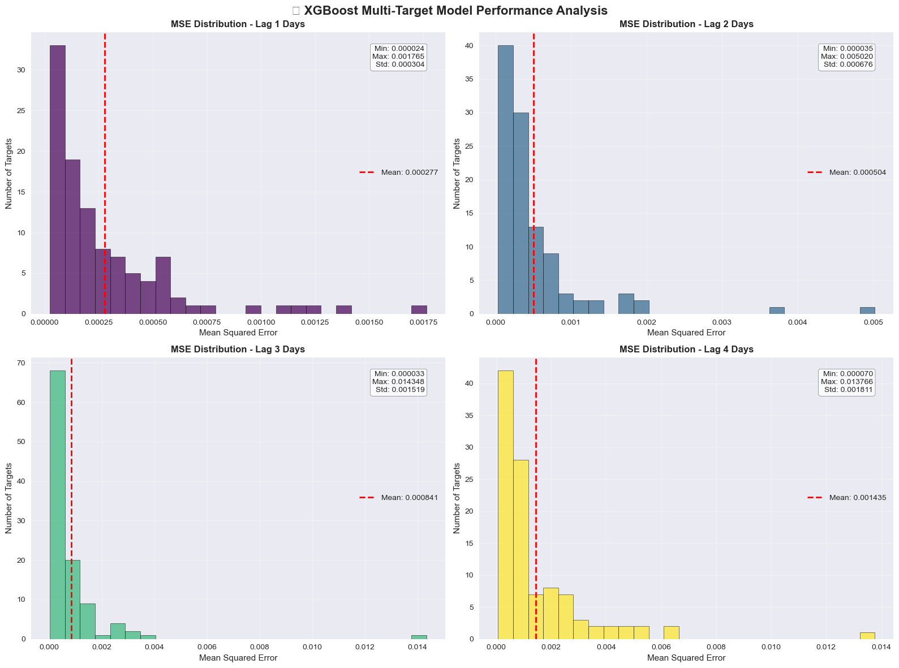

# MITSUI & CO. Commodity Prediction Challenge (Kaggle)

Notebooks from our entry to the Kaggle competition *MITSUI & CO. Commodity Prediction Challenge*: we try to predict 424 daily commodity price signals from historical market data (metals, futures, US stocks and currency rates) using gradient-boosted trees (XGBoost, LightGBM).

## In short

- **Problem:** given daily prices from several markets (London Metal Exchange, Japan Exchange, US stocks and ETFs, foreign exchange), predict 424 "targets": price movements of single instruments or of the difference between two instruments, 1 to 4 days ahead.
- **What we did:** data exploration, first single-target baselines, then two multi-target XGBoost pipelines: one with a separate model per prediction horizon, one with richer feature engineering, plugged into Kaggle's submission API.
- **Main result:** the experiments run end to end and are evaluated on internal validation splits only (see [Results](#results)). No Kaggle leaderboard score is recorded in this repository.
- **Tech:** Python, pandas, scikit-learn, XGBoost, LightGBM, Jupyter.

## Context

The competition was hosted on Kaggle by Mitsui & Co. (competition page: <https://www.kaggle.com/competitions/mitsui-commodity-prediction-challenge>).

- **Input:** one row per trading day (`date_id`) with 557 market columns. The notebooks count them as 4 London Metal Exchange (`LME_*`) closing prices, 40 Japan Exchange futures (`JPX_*`) columns, 475 US stock/ETF columns (`US_Stock_*`: open, high, low, close, volume) and 38 exchange rates (`FX_*`). There are 1,917 training days (shapes printed in `notebooks/XGBoost.ipynb`).
- **Output:** 424 numbers per day, `target_0` to `target_423`. The file `target_pairs.csv` says what each target is built from. Some targets are based on one instrument (for example `target_0` = `US_Stock_VT_adj_close`). Others are based on the difference between two instruments (for example `target_2` = `LME_CA_Close - LME_ZS_Close`). Each target also has a **lag** of 1, 2, 3 or 4 days, and each lag covers exactly 106 targets. The exact mathematical definition of the targets is on the Kaggle data page.
- **How it is scored:** each day, the predicted targets are compared to the true ones with a **Spearman rank correlation**. The final score is the mean of these daily correlations divided by their standard deviation, which is a **Sharpe-ratio-like** measure. This is how `notebooks/model_Josselin.ipynb` implements the metric (function `rank_correlation_score`); the official definition is on the Kaggle page.
- **Submission format:** this is a "code competition". Kaggle runs your notebook and sends you the test data **one day at a time** through an API (the `kaggle_evaluation/` package). Each call gives the day's market data plus the targets of previous days that are now known (`lagged_test_labels`). Your `predict` function must return the 424 predictions for that day.

## Approach

The work is split across four notebooks, which are mostly independent experiments.

1. **Understand the targets** (`data_treatment.ipynb`): split each pair in `target_pairs.csv` into its two instruments (`thing_1`, `thing_2`).
2. **Single-target baseline** (`data_treatment.ipynb`, `LightGBM.ipynb`): predict only `target_0` from the same day's 557 market columns. Rows with any missing value are dropped and the data is split randomly 50/50. The models are XGBoost (`data_treatment`) and LightGBM plus Random Forest (`LightGBM`).
3. **Lag-based multi-target model** (`XGBoost.ipynb`):
   - Create copies of every market column and every target shifted by 1 to 4 days ("lag features").
   - Train one multi-output XGBoost model per lag group (106 targets each). The lag-*k* model uses lag features from day 1 up to day *k*: 981, 1,962, 2,943 and 3,924 features.
   - Evaluate each model with the mean squared error on the last 20% of the rows, without shuffling, so the time order is kept.
   - The notebook also contains several "correction" cells that work through how lag features should be interpreted before settling on this version.
4. **Feature-engineered model for submission** (`model_Josselin.ipynb`):
   - Engineered features: lags (1 to 5 days), rolling means and standard deviations (5, 10 and 20 days), momentum, ratios between LME metals and volatility, for a total of 1,048 features.
   - Data preparation: standardized features and targets with missing values filled by their median.
   - Model: one XGBoost per target (`MultiOutputRegressor`). It is validated on the last 200 days with the rank-correlation Sharpe metric, then retrained on all the data.
   - Submission: the notebook wraps the model in a `predict` function and serves it through Kaggle's inference server. It was written to run on Google Colab.

## Results

All numbers below come from outputs saved inside the notebooks. They are **internal validation scores**, not Kaggle leaderboard scores.

| Notebook | Setup | Metric | Value |
|---|---|---|---|
| `XGBoost.ipynb` | lag-1 model, 106 targets | mean MSE | 0.000277 |
| `XGBoost.ipynb` | lag-2 model, 106 targets | mean MSE | 0.000504 |
| `XGBoost.ipynb` | lag-3 model, 106 targets | mean MSE | 0.000841 |
| `XGBoost.ipynb` | lag-4 model, 106 targets | mean MSE | 0.001435 |
| `XGBoost.ipynb` | average over the 4 lag groups | mean MSE | 0.000764 |
| `data_treatment.ipynb` | XGBoost, `target_0` only | MSE | 0.0001 (printed with 4 decimals only) |
| `LightGBM.ipynb` | LightGBM + Random Forest, `target_0` | MSE | no result: the saved run stopped with an error (see below) |
| `model_Josselin.ipynb` | XGBoost, 1,048 features | rank-correlation Sharpe | not recorded: the saved output stops during validation training |



*Distribution of the test MSE over the 106 targets of each lag group. The figure was taken from the output of `notebooks/XGBoost.ipynb`. Longer horizons give larger errors.*

**Limitations (please read):**

- **MSE is not the competition metric.** A low MSE mostly reflects that daily price changes are small numbers. It says little about whether the model ranks the targets correctly each day, which is what the competition scores.
- **Very little data in `XGBoost.ipynb`.** After creating lag features, the notebook drops every row with at least one missing value. Only **100 of the 1,917 days remain** (printed in the notebook), so each model is trained on 80 days and tested on 20 days with up to 3,924 features. The scores are therefore very noisy.
- **Possible look-ahead leakage.** `XGBoost.ipynb` uses past values of the targets as features. On Kaggle, a target only becomes known several days later (this is why the API provides `lagged_test_labels`), so this should be checked. In the test-time function `predict_all_targets` these target features are simply set to 0.
- **`model_Josselin.ipynb` builds features for one day at a time.** At submission time, `predict` calls `create_features` on a single day of test data. Lag and rolling features therefore cannot use earlier days and fall back to fill values.
- **`LightGBM.ipynb` does not run with recent LightGBM.** It passes `early_stopping_rounds` to `lgb.train`, which LightGBM 4.x no longer accepts. The saved output shows this `TypeError`.
- The baselines in `data_treatment.ipynb` and `LightGBM.ipynb` use a **random** train/test split on time-series data, which tends to give optimistic scores.

## Repository structure

```
MITSUI-CO_Kaggle/
├── notebooks/
│   ├── data_treatment.ipynb   # parse target_pairs.csv + XGBoost baseline on target_0 + feature-importance plot
│   ├── LightGBM.ipynb         # LightGBM and Random Forest baselines on target_0 (saved run ended in an error)
│   ├── XGBoost.ipynb          # data exploration + one multi-target XGBoost model per lag group (main analysis)
│   └── model_Josselin.ipynb   # feature engineering + XGBoost + Kaggle inference server (submission notebook, Colab)
├── kaggle_evaluation/         # THIRD-PARTY: Kaggle-provided API used to serve test data during submission
│   ├── mitsui_gateway.py      #   reads test.csv + lagged_test_labels/ and sends them one day at a time
│   ├── mitsui_inference_server.py  # wraps your predict() function so the gateway can call it
│   └── core/                  #   generic Kaggle gRPC client/server code (incl. generated protobuf files)
├── figures/
│   └── xgboost_mse_by_lag.png # MSE histogram per lag group, extracted from XGBoost.ipynb
├── data/                      # NOT in the repo: put the Kaggle files here (see "How to run")
├── requirements.txt           # Python packages used by the notebooks
└── .gitignore                 # keeps data, caches and checkpoints out of git
```

## How to run

**Prerequisites:** Python 3.10 or newer (the notebooks were last run with 3.11), and a Kaggle account that has accepted the competition rules.

1. Install the dependencies:
   ```bash
   pip install -r requirements.txt
   ```
2. Download the competition data into `data/`. The data is **not included** in this repository because Kaggle's rules do not allow redistributing it.
   ```bash
   # needs a Kaggle API token: https://www.kaggle.com/docs/api
   kaggle competitions download -c mitsui-commodity-prediction-challenge -p data
   cd data && unzip mitsui-commodity-prediction-challenge.zip && cd ..
   ```
   Afterwards `data/` should contain `train.csv`, `train_labels.csv`, `test.csv`, `target_pairs.csv` and the folder `lagged_test_labels/`.
3. Start Jupyter **from the `notebooks/` folder**, because the notebooks read the data from `../data/`:
   ```bash
   cd notebooks
   jupyter notebook
   ```
4. Suggested order. The notebooks do not depend on each other's outputs and write no files.
   1. `data_treatment.ipynb` shows the target pairs table, the `target_0` baseline MSE and a feature-importance plot.
   2. `LightGBM.ipynb` runs the LightGBM and Random Forest baselines. It needs `lightgbm<4` or a fix of the `early_stopping_rounds` argument.
   3. `XGBoost.ipynb` contains the exploration and the per-lag models, and prints the MSE tables and plots shown above.
   4. `model_Josselin.ipynb` trains the submission model and runs Kaggle's local gateway on `../data`. Its second cell, an empty cell whose saved output shows files copied from Google Drive, was used on Colab and is not needed locally.

## Glossary

- **Target:** a value the model must predict. Here there are 424 per day.
- **Lag:** how many days in the past a value is taken from. A "lag-2 target" is defined over a 2-day horizon, and a "lag-2 feature" is a column shifted by 2 days.
- **Feature:** an input column given to the model.
- **Feature engineering:** creating new input columns from raw data, for example moving averages.
- **Rolling mean / std:** the average or standard deviation over the last *N* days, recomputed every day.
- **Momentum:** the relative change of a price over the last *N* days.
- **XGBoost / LightGBM:** libraries for **gradient-boosted decision trees**. They build many small decision trees, each one correcting the errors of the previous ones.
- **Random Forest:** many decision trees trained on random subsets of the data, with their predictions averaged.
- **Multi-output regression:** predicting several numbers at once. `MultiOutputRegressor` simply trains one model per target.
- **MSE (mean squared error):** the average of (prediction − truth)². Lower is better.
- **Spearman rank correlation:** a correlation computed on ranks instead of raw values. It measures whether the predictions put the targets in the right order (1 = same order, 0 = no relation).
- **Sharpe ratio:** mean divided by standard deviation. Here it rewards scores that are good **and** stable from day to day.
- **Train/validation split:** keeping part of the data aside to measure performance on data the model did not see.
- **Look-ahead leakage:** accidentally using information that would not yet be known at prediction time, which makes validation scores look better than reality.
- **Feature importance:** how much each input column was used by the tree model.
- **StandardScaler:** rescales each column to mean 0 and standard deviation 1.
- **LME / JPX / FX:** London Metal Exchange, Japan Exchange Group, and foreign exchange (currency rates).
- **Inference server / gateway:** Kaggle's mechanism for code competitions. The gateway sends test data to your `predict` function and collects the answers.

## Credits and license

- Authors: Khalil Bibi, with teammate **Josselin**, who wrote `model_Josselin.ipynb` according to the file name. No other team members are documented.
- `kaggle_evaluation/` is **third-party code provided by Kaggle** for this competition. It is not our work and is kept unchanged except for removing compiled `__pycache__` files. It ships without a license file; its terms are those of the competition.
- Competition data: © the competition host. Download it from Kaggle; it is not redistributed here.
- No license has been chosen yet for the notebooks in this repository.
